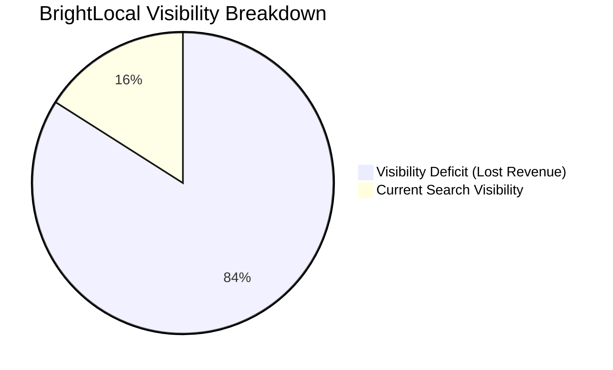
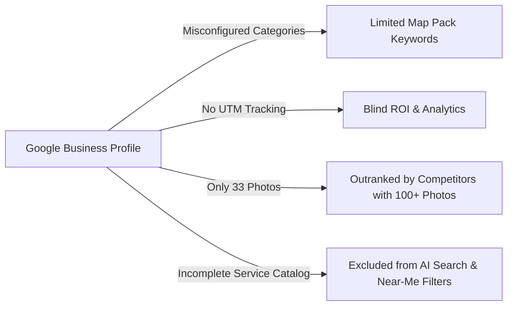
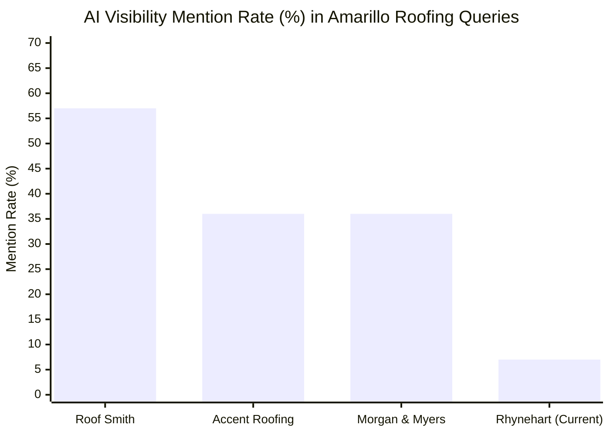
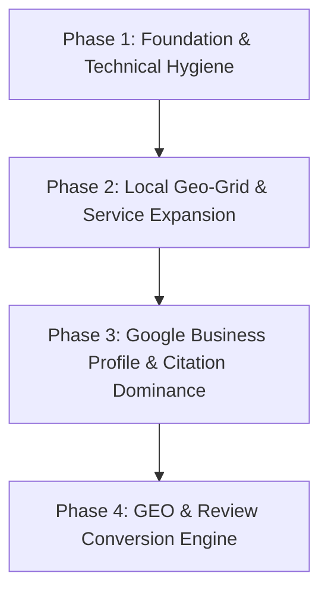

# Local SEO Audit & Growth Proposal: Rhynehart Roofing, Inc.
**Audit Date:** November 2026  
**Target Domain:** [rhynehart.com](https://www.rhynehart.com)  
**Location:** 6900 West McCormick Road, Amarillo, TX 79118  
**Phone:** (806) 622-0090  
**Data Sources:** BrightLocal Location Intelligence (#4191821), Google PageSpeed Insights, Local Search Grid (LSG), Schema Validator.

---

## Executive Summary

Rhynehart Roofing possesses exceptional customer loyalty (**4.9★ across 96 Google Reviews**) and strong domain history (**23-year-old domain registered in 2003, DA 22**). Furthermore, key personnel (René Montoya and Dale Orr) are frequently highlighted in client reviews for exceptional service and integrity during insurance roof claims.

Despite these significant trust assets, **the company's digital visibility is severely impaired**:

* **Overall Local Score:** **45 / 100** (Critical deficiency)
* **Foundation Score:** **74 / 100** (Solid sentiment, undermined by technical and on-page gaps)
* **Local Visibility Score:** **16 / 100** (Virtually invisible outside immediate rural shop vicinity)
* **Local AI Visibility Score:** **6 / 100** (0% mention rate in Google AI Overview & Gemini Mode)

### The Core Problem: The 1-Mile Radius Barrier
Rhynehart Roofing ranks **#1 to #3** within 1 mile of its physical location on West McCormick Road (ZIP 79118). However, as search queries move north toward downtown Amarillo, Wolflin, the Medical Center, Soncy, and high-value residential developments, **rankings collapse to #15–#50+**. Competitors like *TRX Roofing*, *Andrus Brothers*, *Roof Smith*, and *Accent Roofing* are capturing over **85% of high-intent search traffic and storm damage replacements**.

---

## Detailed Audit Breakdown: Identified Problems

### 1. Website Technical & On-Page SEO Deficiencies

| Audit Checkpoint | Current State on rhynehart.com | Impact Level |
| :--- | :--- | :--- |
| **H1 Tag Structure** | **0 H1 tags on the entire website**. Pages start directly at H2. | **CRITICAL**: Search engines cannot establish primary keyword topics. |
| **Indexed Orphan / Duplicate Page** | `/copy-of-services` is indexed with a misspelled title tag: `...Sevices`. | **HIGH**: Keyword cannibalization and unprofessional technical hygiene. |
| **Meta Descriptions** | **100% duplicate** across all 5 pages (identical 152-char snippet). | **HIGH**: Low click-through rates (CTR) in search results. |
| **Thin Content** | Average page length is only **317 words**. Services page has only 399 words. | **CRITICAL**: Inability to rank for secondary or high-ticket service keywords. |
| **Physical Address Markup** | **0 of 5 pages** display crawlable street address (even `/contact` lacks street text). | **CRITICAL**: Disconnects the website from the Google Business Profile NAP. |
| **Click-to-Call** | Phone numbers are rendered in static plain text, not `tel:+18066220090`. | **MEDIUM**: Destroys mobile user conversion. |
| **Image Alt Attributes** | **53 out of 70 images** (75.7%) lack descriptive alt text. | **MEDIUM**: Lost Google Image traffic and poor accessibility. |
| **Schema.org Structured Data** | Incomplete microdata. Missing geo-coordinates, street address, operating hours. | **HIGH**: Google Knowledge Graph cannot verify business entity. |
| **Core Web Vitals & Mobile Speed** | Mobile PageSpeed score is **55 / 100**; unoptimized script loads. | **HIGH**: High bounce rate on mobile users during storm emergencies. |

---

### 2. Google Business Profile (GBP) Disconnects

1. **Underutilized Categories:** Currently only utilizing *Roofing contractor* and *Siding contractor*. Missing high-volume secondary categories: *Gutter service*, *Construction Company*, *Repair service*.
2. **Missing Service Catalog Attributes:** Lacks itemized services like *Hail Damage Inspection*, *Wind Damage Repair*, *TPO Commercial Roofing*, *Emergency Leak Repair*, *Insurance Claim Assistance*.
3. **Photo Deficit:** Rhynehart has **33 photos**, while direct competitors maintain 100+ high-resolution, geo-rich job site photos (*Accent Roofing*: 104 photos, *Roof Smith*: 61 photos, *Ortiz Construction*: 120 photos).
4. **Zero Lead Attribution (UTM):** Website link lacks UTM tagging (`?utm_source=google&utm_medium=gbp`), leaving management blind to exact phone calls and form submissions coming from Google Maps.
5. **Operating Hours Limitation:** Mon–Fri 9AM–5PM (Closed weekends). Competitors advertise 24/7 emergency response, capturing lucrative storm and emergency leak calls.

---

### 3. Citations & Directory Inconsistencies

* **Key Citation Score:** **56 / 100** (Covering only 50% of core tier-1 directories).
* **Unclaimed Profiles:** 100% of detected citations are currently unclaimed, leaving profiles vulnerable to automated overrides or incorrect data.
* **Missing Tier-1 Contractor Directories:**
  * **Angi.com (DA 86)** — Missing (Competitors hold leading sponsored and organic spots).
  * **BuildZoom.com (DA 60)** — Missing contractor license verification profile.
  * **Facebook Business Page** — Unlinked and missing local citation synchronization.
  * Incomplete listings on *BrownBook*, *YellowBook*, *Bizapedia*, *Cybo*, *EzLocal*.
* **NAP Discrepancies:** ZIP format mismatch (`79118` vs `79118-3005`) between BBB and Google Business Profile.

---

### 4. Generative Engine Optimization (GEO) & AI Search Deficit

When potential customers ask AI engines (ChatGPT, Google AI Overview, Gemini) for contractor recommendations in Amarillo, **Rhynehart Roofing scores 6 / 100**:

* **Query: "urgent roof leak repair in Amarillo"** → Rhynehart Mention: **0%**
* **Query: "contractor for hail damage roof inspection"** → Rhynehart Mention: **0%**
* **Query: "contractor to replace roof Amarillo"** → Rhynehart Mention: **0%**
* **Why Competitors Win AI Mentions:** Competitors explicitly feature RCAT certifications, drone inspection landing pages, insurance negotiation workflows, and structured Q&A schema that large language models ingest.

---

## 4-Phase Turnkey Action Plan (What We Will Solve)

### Phase 1: Technical Fixes & On-Page Foundation (Immediate - Month 1)
1. **Header Tag Realignment:**
   * Rewrite and implement a unique, keyword-optimized `<h1>` on every page (e.g., Homepage: *Trusted Amarillo Roofing Contractor & Storm Restoration Experts*).
   * Restructure all subheadings hierarchically into clean `<h2>` and `<h3>` tags.
2. **Duplicate URL Cleanup & Redirects:**
   * Execute permanent 301 redirect from `/copy-of-services` to `/services`.
   * Correct page title spelling (`Sevices` → `Services`).
   * Remove orphan pages from Google Search Console index.
3. **NAP & Click-to-Call Implementation:**
   * Hardcode full corporate NAP (*Rhynehart Roofing, Inc. | 6900 W McCormick Rd, Amarillo, TX 79118*) in crawlable HTML into the global footer and Contact page.
   * Format all telephone instances into one-tap mobile click-to-call links (`tel:+18066220090`).
4. **Unique Meta Data Architecture:**
   * Craft customized, conversion-focused title tags and meta descriptions for all pages with explicit Amarillo local qualifiers.
5. **JSON-LD Schema Markup:**
   * Deploy Google-compliant `RoofingContractor` and `LocalBusiness` schema with exact latitude/longitude coordinates, business hours, and social `sameAs` entity links.
6. **Mobile Speed Optimization & Image Optimization:**
   * Compress heavy image assets, add descriptive alt tags to all 53 missing images, and boost mobile PageSpeed score to 85+.

---

### Phase 2: Content Architecture & Local Geo-Grid Expansion (Months 1–2)
Rather than relying on a single 399-word services page, we will build out high-converting, dedicated 800+ word landing pages targeting the specific commercial keywords where Rhynehart is currently invisible:

1. **Service-Specific Landing Pages:**
   * *Residential Roof Replacement in Amarillo, TX*
   * *Emergency Hail & Wind Storm Damage Repair*
   * *Commercial Flat Roofing & TPO Systems*
   * *Free Drone Roof Inspections & Leak Detection*
   * *Class 4 Impact-Resistant Shingle Installations*
2. **Dedicated Insurance Claims Page:**
   * Highlight René Montoya and Dale Orr’s established expertise in meeting adjusters on-site, providing free damage estimates, and navigating carrier paperwork without out-of-pocket surprise costs.
3. **Hyperlocal Neighborhood Hubs:**
   * Build targeted service pages for key growth areas outside the 79118 zip code: **Bushland, Canyon, Wolflin, Puckett, Western Plateau, and Soncy Road corridor**.

---

### Phase 3: Google Business Profile & Citation Blast (Months 2–3)
1. **Google Business Profile Optimization:**
   * Configure primary category as *Roofing contractor*, and activate secondary categories: *Gutter service*, *Construction Company*, *Roofing supply store*.
   * Build a complete, comprehensive Service Catalog itemizing all residential and commercial services.
   * Add UTM tracking parameters to measure phone calls, directions, and website leads cleanly in Google Analytics 4.
   * Expand photo library by adding 50+ geo-tagged, branded project photos showcasing local Amarillo jobs.
2. **Citation Authority Campaign:**
   * Claim and verify primary missing profiles on **Angi (DA 86)**, **BuildZoom (DA 60)**, and **Facebook Business**.
   * Standardize NAP across 40+ national and local trade directories to eliminate formatting variations.

---

### Phase 4: Generative Engine Optimization (GEO) & Review Engine (Ongoing)
1. **Generative Search Optimization (AI Overviews & ChatGPT):**
   * Integrate structured FAQ schemas answering storm damage and insurance questions.
   * Prominently cite Roofing Contractors Association of Texas (RCAT) licensing and BBB A+ credentials so AI models cite Rhynehart as a verified authority.
2. **Keyword-Targeted Review Funnel:**
   * Implement automated post-job review request workflows guiding satisfied customers to mention key services (*"hail damage repair in Amarillo"*, *"seamless insurance claim"*, *"Dale and René were fantastic"*) directly in Google reviews.

---

## Projected Outcomes & Growth Timeline

| Milestone | Expected Result | Timeframe |
| :--- | :--- | :--- |
| **Month 1** | Zero crawling errors, 100% clean schema, full NAP consistency, duplicate URL removed. | Day 1–30 |
| **Month 2** | Expanded keyword footprint across 6+ new service pages; GBP category and citation lift. | Day 30–60 |
| **Month 3** | Breaking out of the 1-mile geofence; Top 3 Map Pack penetration in Central and North Amarillo. | Day 60–90 |
| **Month 6** | 3x to 5x increase in qualified organic phone calls and inbound roof replacement quote requests. | Day 90–180 |

---
*Report prepared for strategic execution by Antigravity Local SEO Systems.*
